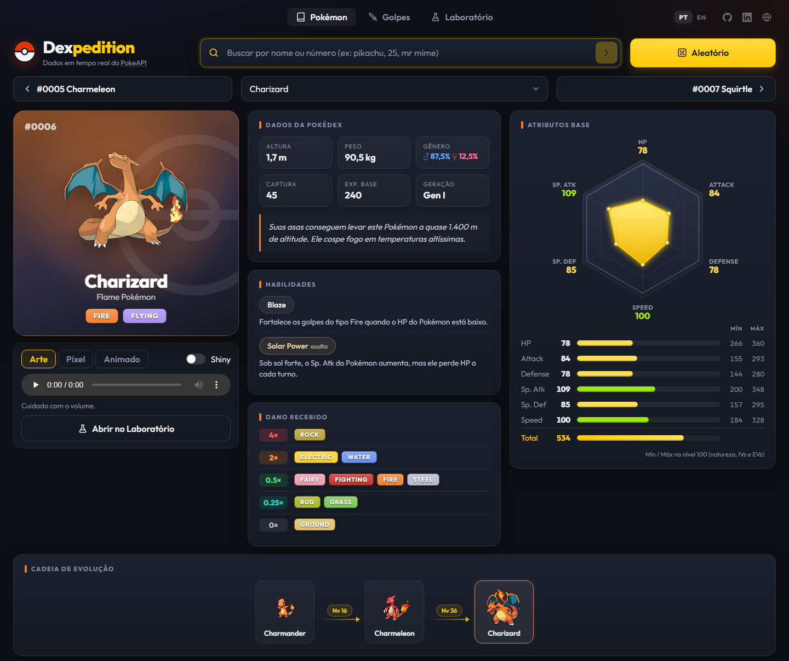
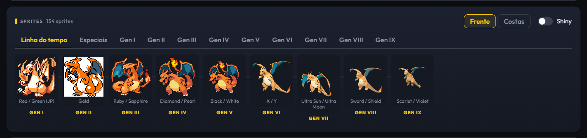
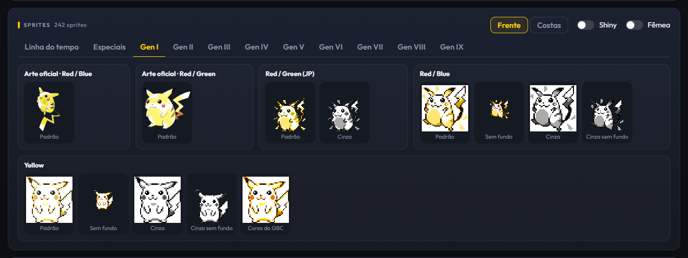
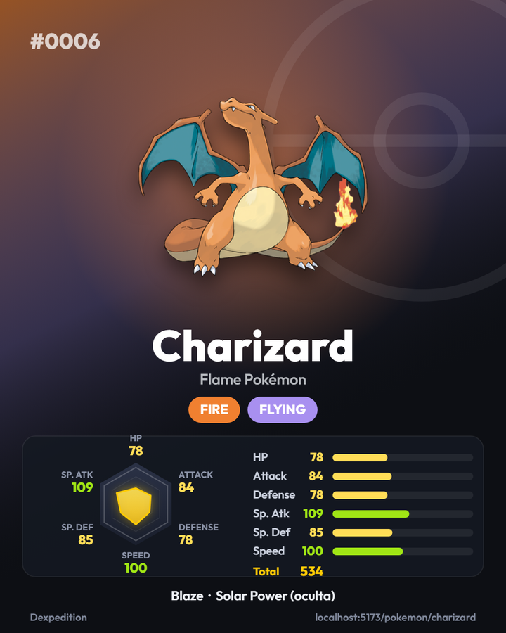
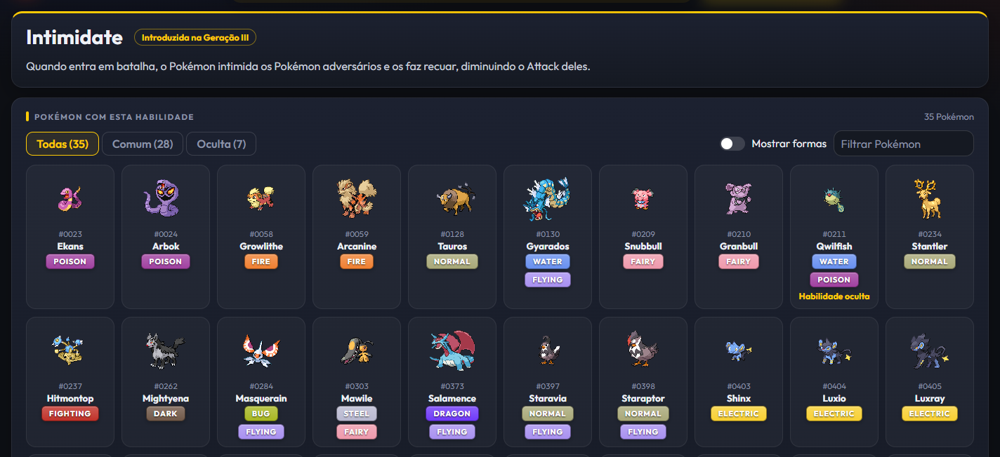
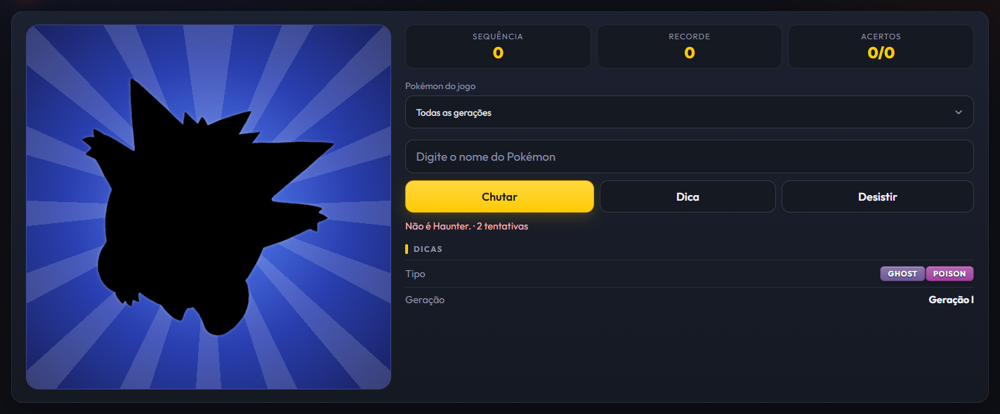
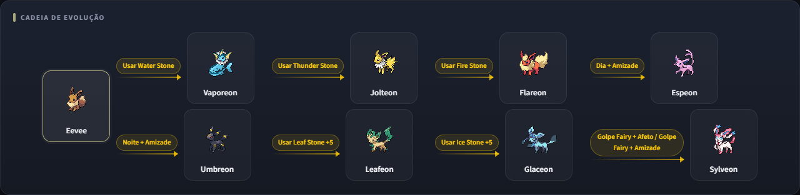

<h1 align="center">Dexpedition</h1>

<p align="center">
  Pokédex web interativa construída com React, TypeScript e Vite, com dados em tempo real da <a href="https://pokeapi.co/">PokeAPI</a>.
</p>

<p align="center">
  
  
  
  
</p>

<p align="center">
  
</p>

## Sumário

- [Visão geral](#visão-geral)
- [Funcionalidades](#funcionalidades)
- [Idiomas](#idiomas)
- [Stack](#stack)
- [Arquitetura](#arquitetura)
- [Executando localmente](#executando-localmente)
- [Deploy](#deploy)
- [Estrutura do projeto](#estrutura-do-projeto)
- [Roadmap](#roadmap)
- [Créditos](#créditos)

## Visão geral

O projeto reúne em uma única tela as informações mais consultadas sobre um Pokémon: tipos, atributos base, fraquezas e resistências, habilidades, formas alternativas, a cadeia de evolução completa e todos os sprites de todos os jogos. Além da ficha de cada Pokémon, há uma lista navegável de todos os Pokémon, seções de golpes, habilidades e itens que mostram quem aprende, tem ou usa cada um, um laboratório com calculadora e comparador de atributos e o minijogo "Quem é esse Pokémon?". A interface segue a linguagem visual dos jogos da série principal, com layout em colunas no desktop e empilhado em telas menores.

A aplicação roda inteiramente no navegador: não há backend, e todos os dados vêm direto da PokeAPI.

## Funcionalidades

### Busca e navegação

- Busca por nome ou número da Pokédex nacional, tolerante a espaços, pontuação e acentos (`mr mime`, `deoxys`, `25`, `flabébé`), com sugestões enquanto você digita: sprite, número e tipos de cada Pokémon, navegação pelo teclado e tolerância a pequenos erros (`chrzd` → Charizard).
- Navegação sequencial pela numeração nacional, exibindo o nome do Pokémon anterior e do próximo.
- Sorteio de um Pokémon aleatório entre todas as espécies disponíveis na API.
- Minijogo "Quem é esse Pokémon?" a um clique, ao lado do sorteio (veja abaixo).
- Lista de todos os Pokémon na página inicial, em grade com sprite, número e tipos. Filtra por nome, por até dois tipos (ex.: Fire + Flying), por geração (ou só os disponíveis em Pokémon Champions) e por habilidade (ex.: quem pode ter Intimidate, marcando quando ela é oculta), e ordena por número, nome, total ou um atributo específico (ex.: os mais rápidos). Formas alternativas aparecem com um clique.
- URLs próprias para cada Pokémon (`/pokemon/charizard`), permitindo compartilhar links e usar o histórico do navegador. Links antigos no formato `?p=charizard` continuam funcionando.

### Informações exibidas

| Seção | Conteúdo |
| --- | --- |
| Card principal | Arte oficial, sprite em pixel ou animado, versão shiny, grito do Pokémon, tipos, categoria e marcação de lendário, mítico ou bebê. Gera uma imagem para compartilhar (PNG 1080×1350, no formato dos stories) com arte, tipos, hexágono de atributos e habilidades: no celular abre o menu de compartilhar, no computador baixa o arquivo |
| Dados da Pokédex | Altura, peso, proporção de gênero, taxa de captura, experiência base, geração e descrição |
| Habilidades | Habilidades regulares e oculta, com a descrição de cada uma e link para a página da habilidade |
| Dano recebido | Multiplicadores 4×, 2×, 0.5×, 0.25× e 0× calculados a partir da combinação de tipos. Habilidades que reduzem golpes superefetivos (Filter, Solid Rock e Prism Armor) são detectadas automaticamente e geram as faixas 3× e 1.5×. Quando o Pokémon tem outras habilidades, um seletor alterna entre elas |
| Atributos base | Hexágono no estilo de Sword/Shield, barras por faixa de valor e mínimo/máximo no nível 100 |
| Formas alternativas | Mega, Gigantamax, formas regionais e demais variedades da espécie |
| Evolução | Árvore completa com ramificações (ex.: Eevee, Wurmple), métodos de evolução e links para cada estágio |
| Onde encontrar | Mapa ilustrado de cada região (Kanto a Galar, mais Orre e Sevii Islands), desenhado para o projeto, com os locais destacados e cartões que explicam, em linguagem simples, como achar o Pokémon: ação, nível, raridade e condições, do lugar mais fácil ao mais difícil (dados da PokeAPI até Sword/Shield). Em jogos onde o Pokémon só vem por evolução, mostra o local da pré-evolução. Iniciais, lendários e míticos sem registro têm dados curados à mão |
| Golpes | Golpes aprendidos por nível, ovo, MT e tutor em cada jogo, com tipo, categoria, poder, precisão, PP e efeito. Cada golpe abre a página dele |
| Sprites | Todos os sprites que a PokeAPI tem para o Pokémon (mais de 200 no Pikachu), em abas por geração: arte oficial, HOME, Dream World, Showdown e cada jogo, de Red/Green a Champions, com as variantes cinza, GBC, sem fundo, animada e ícone. Filtros de frente/costas, shiny e fêmea (só quando há diferença). A aba "Linha do tempo" mostra um sprite por geração lado a lado. Clicar em um sprite o leva para o card principal |

As preferências de exibição (estilo da imagem, shiny, jogo selecionado nos golpes e aba da galeria de sprites) ficam salvas no navegador.

<p align="center">
  
</p>

<p align="center">
  
</p>

A imagem para compartilhar usa o que o card está mostrando no momento (arte, pixel, shiny ou um sprite escolhido na galeria):

<p align="center">
  
</p>

### Golpes

Seção própria (`/golpes`), acessível pelo menu no topo.

- **Lista de golpes**: todos os golpes que algum Pokémon aprende, com busca por nome, filtros de tipo, categoria e geração, e colunas ordenáveis (ex.: os mais fortes primeiro).
- **Página do golpe** (`/golpe/flamethrower`): tipo, categoria, poder, precisão, PP, efeito e número da MT, além de todos os Pokémon que aprendem o golpe no jogo escolhido. Os Pokémon ficam separados em abas por método (nível, ovo, MT, tutor), com sprite e o nível em que aprendem, incluindo formas alternativas.
- **Botão de voltar contextual**: volta ao Pokémon de origem ("Voltar para Charizard") ou à lista de golpes com os mesmos filtros ("Voltar para Golpes").

Os filtros das listas ficam na URL, então voltar pelo navegador ou compartilhar o link mantém a lista exatamente como estava.

### Habilidades

Seção própria (`/habilidades`), acessível pelo menu no topo.

- **Lista de habilidades**: todas as habilidades da série principal, com busca por nome, filtro de geração e colunas ordenáveis (ex.: as mais comuns primeiro).
- **Página da habilidade** (`/habilidade/intimidate`): descrição, geração em que surgiu e todos os Pokémon que podem tê-la, separados entre comum e oculta, com busca e opção de incluir formas alternativas.
- **Botão de voltar contextual**, como nos golpes: volta ao Pokémon de origem ou à lista com os mesmos filtros.

<p align="center">
  
</p>

### Itens

Seção própria (`/itens`), acessível pelo menu no topo.

- **Lista de itens**: cerca de 1.100 itens com busca por nome, filtros de categoria, geração e só os de Pokémon Champions, e colunas ordenáveis. Ficam de fora MTs (já cobertas em Golpes), cristais Dynamax, materiais de MT, ingredientes de sanduíche e itens sem uso nos jogos.
- **Página do item** (`/item/leftovers`): descrição, categoria, geração, preço, características, efeito com o golpe Fling, texto em cada jogo, itens parecidos e os Pokémon relacionados: quem Mega Evolui com ele, quem evolui usando ele e quais Pokémon selvagens podem segurá-lo.

### Quem é esse Pokémon?

Minijogo (`/quem-e-esse`), aberto pelo botão ao lado de "Aleatório".

- A silhueta do Pokémon aparece sobre os raios do desenho animado; digite o nome em até três tentativas, com sugestões e tolerância a pequenos erros de digitação (`grudon` → Groudon). Um palpite que é outro Pokémon nunca vale (`porygon` não acerta Porygon2).
- Dicas reveladas uma de cada vez: tipo, geração, grito e a primeira letra do nome.
- Sequência de acertos, recorde salvo no navegador e opção de jogar só com uma geração.

<p align="center">
  
</p>

### Laboratório

Página separada (`/laboratorio`), acessível pelo menu no topo ou pelo botão "Abrir no Laboratório" no card do Pokémon.

- **Calculadora de atributos reais**: escolha nível, natureza, IVs e EVs e veja os atributos finais no hexágono, com o atributo favorecido pela natureza em vermelho e o desfavorecido em azul, como nos jogos. Inclui atalhos para IVs e distribuições comuns de EVs, e avisa quando o total passa de 510.
- **Comparador**: até três Pokémon com os hexágonos sobrepostos e tabela lado a lado destacando o maior valor de cada atributo, por atributos base ou nos níveis 50 e 100.

<p align="center">
  
</p>

## Idiomas

A interface está em português (PT-BR) e inglês (EN-US), com um seletor discreto no topo. O idioma inicial segue o do navegador (português abre em PT, qualquer outro em EN), e a escolha fica salva.

- **Ficam em inglês nos dois idiomas**: nomes de Pokémon, tipos, golpes, habilidades, itens, jogos, atributos, naturezas e categorias (ex.: Flame Pokémon). Medidas sempre no SI.
- **Traduzidos**: toda a interface e as descrições da Pokédex, dos golpes, das habilidades e dos itens. Como a PokeAPI não tem textos em português, esses ~3.200 textos foram traduzidos e ficam em `src/i18n/content/pt/`. Medidas imperiais das descrições foram convertidas para o SI.
- **Sem custo no modo EN**: as traduções ficam em arquivos separados, baixados só no modo PT. Se a API ganhar um texto novo, ele aparece em inglês até ser traduzido.

## Stack

| Camada | Tecnologia |
| --- | --- |
| Linguagem | TypeScript |
| Interface | React 19, com CSS e SVG próprios (sem biblioteca de componentes) |
| Build | Vite |
| Rotas | React Router |
| Dados e cache | TanStack Query + `fetch` |
| Testes | Vitest |
| Lint | Oxlint |
| Fonte de dados | PokeAPI v2 (REST e GraphQL) |

## Arquitetura

O código é dividido em camadas com responsabilidades separadas:

- **`src/lib/`**: lógica sem dependência de interface.
  - **`pokeapi.ts`**: acesso à PokeAPI. Resolve nomes, busca espécies, tipos, habilidades, golpes e cadeias de evolução, calcula a efetividade de tipos (incluindo o efeito de habilidades) e faz as consultas GraphQL das listas.
  - **`stats.ts`**: regras do jogo: fórmulas de atributos, naturezas e limites de IVs e EVs.
  - **`sprites.ts`**: transforma o objeto de sprites da PokeAPI (aninhado por geração, jogo e variante) em uma lista simples, agrupada e ordenada para a galeria e a linha do tempo.
  - **`game.ts`**: regras do "Quem é esse Pokémon?": conferência do palpite com distância de edição e sorteio sem repetir os recentes.
  - **`share-card.ts`**: desenha a imagem de compartilhamento em canvas, sem biblioteca externa.
  - **`versions.ts`**: jogos em ordem cronológica com o nome de exibição.
  - **`queries.ts`**: definições das consultas do TanStack Query usadas pelas telas.
  - **`format.ts`** e **`types.ts`**: formatação, cores por tipo e a tipagem dos dados da API.
- **`src/components/`**: componentes visuais (cards, hexágono de atributos, árvore de evolução, tabela de golpes, lista de Pokémon) e controles reutilizáveis (select pesquisável, abas, slider, toggle, filtro de tipos).
- **`src/pages/`**: uma página por arquivo (Pokémon, golpes, habilidades, itens, laboratório e o minijogo), responsáveis pelo layout e pelo estado de cada tela.
- **`src/state/`**: estado do Laboratório, compartilhado entre as páginas para não se perder ao navegar.
- **`src/i18n/`**: dicionários da interface (`pt.ts` é a referência, e `en.ts` é tipado a partir dele, então faltar um texto quebra o build) e as traduções das descrições da PokeAPI.

Decisões de desempenho:

- **Cache em duas camadas**: as respostas da PokeAPI ficam em um cache em memória por URL, que também evita requisições duplicadas simultâneas, e o TanStack Query guarda os dados já processados por uma hora.
- **Payload reduzido**: a resposta de `/pokemon` é compactada antes de entrar no cache (a lista de golpes, cerca de 90% do tamanho, vira um índice enxuto por jogo, e os sprites viram uma lista achatada só com as URLs existentes).
- **Só o necessário**: a galeria carrega apenas as imagens da aba aberta, o filtro de habilidade da página inicial só baixa a lista de habilidades quando é usado e o minijogo já baixa a arte da próxima rodada enquanto você pensa.
- **GraphQL para as listas**: a lista de todos os Pokémon, a de todos os golpes e habilidades, "quem aprende este golpe", "quem tem esta habilidade" e as espécies do minijogo usam a API GraphQL da PokeAPI. Cada uma é uma única consulta de poucas dezenas de KB comprimidos, em vez das centenas de requisições REST que seriam necessárias.
- **Listas leves**: os sprites usam carregamento preguiçoso (só os visíveis são baixados), e a filtragem usa `useDeferredValue` para não travar a digitação.
- **Requisições em paralelo**: tipos, habilidades, golpes, MTs e sprites da evolução são buscados em paralelo, com limite de 16 requisições simultâneas.
- **Carregamento independente**: cada seção carrega por conta própria com um esqueleto de carregamento, então a tela aparece antes de todos os dados chegarem.
- **Tratamento de falhas**: erros de rede não são cacheados e resultam em uma mensagem amigável na seção afetada, sem derrubar o restante da página.

## Executando localmente

**Pré-requisitos:** Node.js 20.19 ou superior e `npm`.

```bash
git clone https://github.com/BrianAshihara/pokedex.git
cd pokedex
npm install
npm run dev
```

A aplicação ficará disponível em `http://localhost:5173`.

Outros comandos:

| Comando | Descrição |
| --- | --- |
| `npm run build` | Verifica os tipos e gera a versão de produção em `dist/` |
| `npm run preview` | Serve localmente a versão gerada pelo build |
| `npm test` | Executa os testes unitários |
| `npm run lint` | Executa o lint |
| `npm run i18n:check` | Compara a PokeAPI com as traduções e lista descrições novas, alteradas ou sem uso |
| `npm run i18n:extract` | Atualiza `scripts/i18n-source.en.json`, o inglês de onde cada tradução saiu |
| `npm run data:champions` | Atualiza a lista de itens de Pokémon Champions a partir das estatísticas do Smogon |

## Deploy

O projeto está preparado para a [Vercel](https://vercel.com/):

1. Importe o repositório na Vercel. O framework Vite é detectado automaticamente (build `npm run build`, saída `dist`).
2. Clique em **Deploy**.

O arquivo `vercel.json` redireciona todas as rotas para o `index.html`, para que URLs como `/pokemon/charizard` funcionem ao abrir o link diretamente. Cada push para a branch `main` dispara um novo deploy automaticamente.

## Estrutura do projeto

```
pokedex/
├── assets/                    # Imagens usadas neste README
├── public/
│   └── favicon.svg
├── scripts/                   # Extração e checagem das traduções da PokeAPI
├── src/
│   ├── components/            # Componentes visuais e controles
│   ├── hooks/                 # Hooks reutilizáveis
│   ├── i18n/                  # Dicionários PT/EN e traduções das descrições
│   ├── lib/                   # PokeAPI, fórmulas, formatação, tipos e testes
│   ├── pages/                 # Pokémon, Golpes, Habilidades, Itens, Laboratório e minijogo
│   ├── state/                 # Estado do Laboratório
│   ├── styles/
│   │   └── global.css         # Tema e estilos
│   ├── App.tsx                # Rotas e navegação
│   └── main.tsx               # Ponto de entrada
├── index.html
├── package.json
├── vercel.json                # Rotas da SPA na Vercel
├── vite.config.ts
└── README.md
```

## Roadmap

- [x] Autocomplete na busca, com tolerância a erros de digitação
- [x] Galeria com todos os sprites e linha do tempo por geração
- [x] Seção de habilidades
- [x] Minijogo "Quem é esse Pokémon?"
- [x] Imagem para compartilhar
- [x] Filtros por tipo, geração e categoria
- [ ] Montador de time com análise de cobertura de fraquezas
- [x] Testes automatizados das regras de jogo
- [ ] Pipeline de CI

## Créditos

Desenvolvido por **Brian Ashihara**.

Dados fornecidos pela [PokeAPI](https://pokeapi.co/). Os locais dos iniciais, lendários e míticos sem registro na API foram levantados na [Bulbapedia](https://bulbapedia.bulbagarden.net/). Pokémon e seus respectivos nomes são marcas registradas da Nintendo, Game Freak e The Pokémon Company. Este é um projeto de fãs, sem fins comerciais e sem afiliação oficial.
